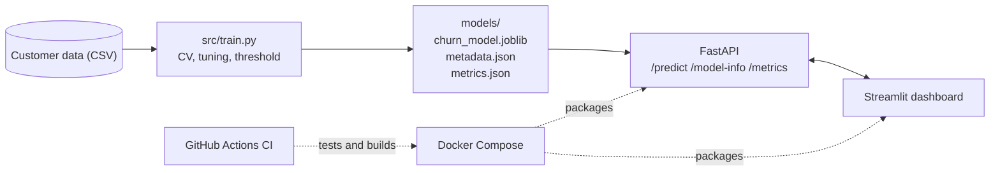

# Telecom Customer Churn Prediction


An end-to-end machine learning service that predicts the probability that a telecom customer will churn. A leakage-safe scikit-learn / XGBoost pipeline is served through a **FastAPI** REST API, explored through a **Streamlit** dashboard, packaged with **Docker Compose**, and verified by **pytest** and **GitHub Actions** CI.

## Features

- **Churn probability and decision** for a single customer, using a decision threshold chosen from cross-validated predictions
- **Leakage-safe modelling:** preprocessing and model live in one scikit-learn `Pipeline`, so nothing is fitted on test data
- **Model comparison:** Dummy baseline, Logistic Regression, Random Forest and XGBoost, compared with stratified 5-fold cross-validation and tuned with `RandomizedSearchCV`
- **REST API** with input validation, health, model-info and metrics endpoints
- **Interactive dashboard** for predictions and model performance
- **One-command start** with Docker Compose
- **Automated checks:** 14 tests, ruff linting, and a Docker build with a live health check on every push

## Architecture



The dashboard never loads the model. It only calls the API, so the two services can run, scale and change independently.

## Tech stack

Python 3.13, pandas, NumPy, scikit-learn, XGBoost, FastAPI, Pydantic, Uvicorn, Streamlit, Docker and Docker Compose, pytest, ruff, GitHub Actions.

## Quick start (Docker)

You need [Docker Desktop](https://www.docker.com/products/docker-desktop/) running. The trained model is already included in `models/`.

```bash
git clone https://github.com/USERNAME/REPO.git
cd REPO
docker compose up --build
```

| Service               | URL                        |
| --------------------- | -------------------------- |
| Dashboard             | http://localhost:8501      |
| API docs (Swagger UI) | http://localhost:8000/docs |

Stop it with `Ctrl+C`, then `docker compose down`.

## Run locally without Docker

```bash
python -m venv venv
# Windows (PowerShell): .\venv\Scripts\Activate.ps1
# macOS / Linux:        source venv/bin/activate
pip install -r requirements.txt

uvicorn api.main:app --reload            # terminal 1: API on http://localhost:8000
streamlit run app/dashboard.py           # terminal 2: dashboard on http://localhost:8501
```

## Using the API

| Method | Endpoint      | Purpose                                                             |
| ------ | ------------- | ------------------------------------------------------------------- |
| `GET`  | `/health`     | Is the API running and the model loaded?                            |
| `GET`  | `/model-info` | Decision threshold, features, allowed categories and numeric ranges |
| `GET`  | `/metrics`    | Cross-validation and test scores from training                      |
| `POST` | `/predict`    | Churn probability and yes/no decision for one customer              |

Every field of the request is optional, because the pipeline imputes missing values. Categorical values must be ones the model saw during training (see `/model-info`). Invalid input returns HTTP 422 with an explanation.

**Request**

```bash
curl -X POST http://localhost:8000/predict \
  -H "Content-Type: application/json" \
  -d '{"governorate": "Cairo", "customer_type": "Individual", "subscription_plan": "WE Plus 40Mbps",
       "payment_method": "Credit Card", "monthly_bill_egp": 400, "tenure_months": 24,
       "complaint_count": 2, "downtime_hours_monthly": 3.5}'
```

On Windows PowerShell:

```powershell
Invoke-RestMethod -Uri http://localhost:8000/predict -Method Post -ContentType "application/json" `
  -Body '{"tenure_months": 24, "complaint_count": 2}'
```

**Response** (example)

```json
{ "churn_probability": 0.87, "will_churn": true, "threshold": 0.45 }
```

## Data

The model uses a telecom customer churn dataset with these columns:

| Column                   | Type         | Description                       |
| ------------------------ | ------------ | --------------------------------- |
| `governorate`            | categorical  | Customer's governorate            |
| `customer_type`          | categorical  | Type of customer account          |
| `subscription_plan`      | categorical  | Internet plan                     |
| `payment_method`         | categorical  | How the customer pays             |
| `monthly_bill_egp`       | numeric      | Monthly bill in EGP               |
| `tenure_months`          | numeric      | Months as a customer              |
| `complaint_count`        | numeric      | Number of complaints              |
| `downtime_hours_monthly` | numeric      | Monthly service downtime in hours |
| `churned`                | target (0/1) | Whether the customer churned      |

`customer_id` identifies a row but is never used as a feature. The data file is not included in this repository. To retrain, place it at `data/WE_Churn_Modeling_Dataset.csv`.

## How the model is built

1. **Cleaning:** exact duplicate rows are removed, and rows whose `customer_id` appears more than once with different values are dropped. Both happen **before** the train/test split.
2. **Split:** stratified 80/20 train/test split with a fixed seed.
3. **Pipeline:** median imputation for numeric columns, most-frequent imputation plus one-hot encoding for categorical columns, then the model. Logistic Regression also uses a `RobustScaler`. Unknown categories at prediction time are handled safely.
4. **Model selection:** a majority-class baseline, Logistic Regression, Random Forest and XGBoost are compared with stratified 5-fold cross-validation on the training set (ROC-AUC, PR-AUC, recall, F1). Random Forest and XGBoost are then tuned with `RandomizedSearchCV` over the whole pipeline, optimising PR-AUC because churners are the minority class.
5. **Threshold:** the decision threshold maximises F1 on out-of-fold predictions from the training set, never on the test set.
6. **Evaluation:** the held-out test set is used once, at the end.
7. **Artifacts:** `models/churn_model.joblib` (the full fitted pipeline), `metadata.json` (features, categories, threshold, library versions) and `metrics.json` (all scores).

Retrain with:

```bash
python src/train.py              # add --n-iter 5 for a quick run
```

After retraining, rebuild the Docker image (`docker compose up --build`) so it contains the new model.

## Results

<!-- Run `python src/print_metrics.py` and paste the tables it prints here. -->

Final scores on the held-out test set, and the cross-validation comparison of the candidate models:

| Metric  | Test set  |
| ------- | --------- |
| ROC-AUC | _fill in_ |
| PR-AUC  | _fill in_ |
| Recall  | _fill in_ |
| F1      | _fill in_ |

## Testing and CI

```bash
pip install -r requirements-dev.txt
ruff check .
pytest -v
```

The 14 tests cover the API (health, model info, valid and partial predictions, rejection of invalid input, a risky-versus-safe sanity check) and the saved model (one-row prediction, missing values, unseen categories, matching library versions).

On every push and pull request, GitHub Actions runs two jobs: **test** (install, ruff, pytest) and **docker** (build the image, start the container and check `/health`).

## Project structure

```
.
├── api/                    FastAPI service (main.py)
├── app/                    Streamlit dashboard (dashboard.py)
├── src/
│   ├── train.py            Train, evaluate and save the model
│   └── print_metrics.py    Print results as Markdown tables
├── notebooks/              EDA and modelling walkthrough
├── models/                 Saved model, metadata and metrics
├── tests/                  pytest tests
├── .github/workflows/      CI pipeline
├── Dockerfile
├── docker-compose.yml
├── requirements.txt        Runtime dependencies (pinned)
└── requirements-dev.txt    Test and lint tools
```
